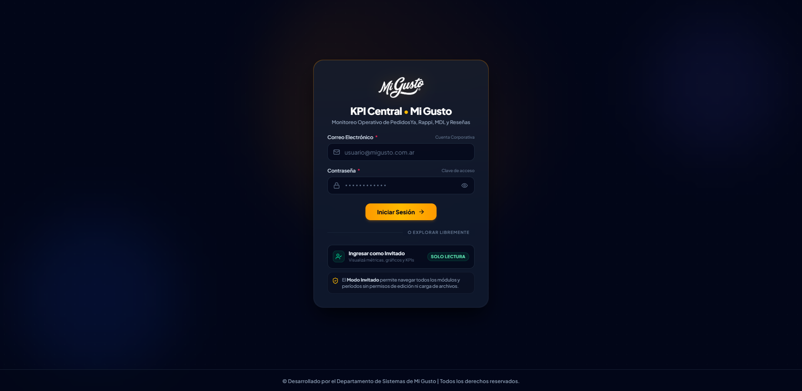
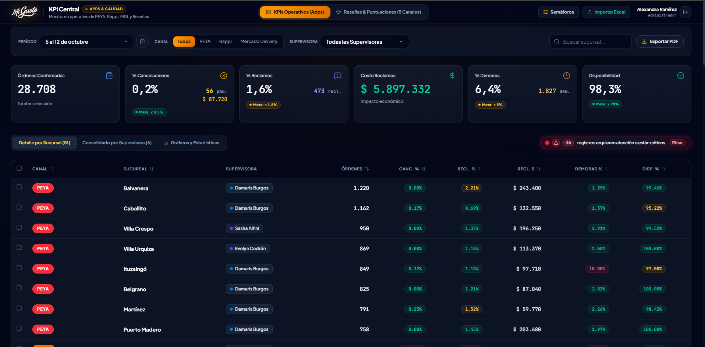
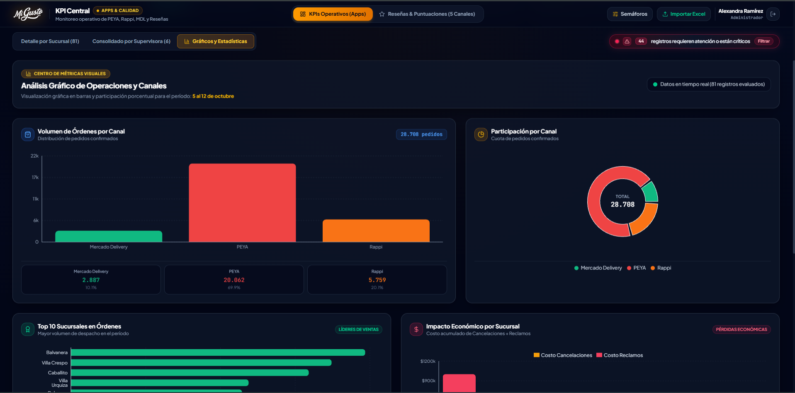
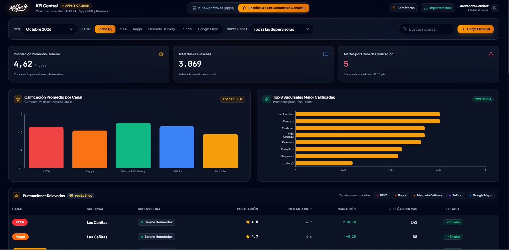

<div align="center">

  

  # KPI Central • Mi Gusto
  ### Portal de Monitoreo y Rendimiento Operativo & Reseñas de Calidad

  [](https://react.dev/)
  [](https://vitejs.dev/)
  [](https://tailwindcss.com/)
  [](https://greensock.com/gsap/)
  [](#)

  <p align="center">
    <strong>Sistema corporativo de analítica en tiempo real para el seguimiento de rendimiento de sucursales, auditoría de delivery apps (PedidosYa, Rappi, Mercado Delivery) y gestión integral de reputación en canales digitales.</strong>
  </p>

</div>

---

## 📸 Galería del Sistema

<div align="center">

### Fila 1 • Acceso Corporativo y Métricas Operativas

<table width="100%">
  <tr>
    <td width="50%" align="center" valign="top">
      
      <br />
      <b>🔐 Portal de Acceso & Autenticación RBAC</b>
      <p><em>Ingreso corporativo seguro con distinción de roles (Administrador y Visualizador en Solo Lectura).</em></p>
    </td>
    <td width="50%" align="center" valign="top">
      
      <br />
      <b>📊 Tablero Operativo & Detalle por Sucursal</b>
      <p><em>Control de órdenes confirmadas, % cancelaciones, reclamos, demoras, disponibilidad y semáforos.</em></p>
    </td>
  </tr>
</table>

### Fila 2 • Centro Gráfico y Auditoría de Reseñas

<table width="100%">
  <tr>
    <td width="50%" align="center" valign="top">
      
      <br />
      <b>📈 Análisis Gráfico & Métricas Visuales</b>
      <p><em>Visualización comparativa de volumen por canal, participación porcentual y costo económico de incidencias.</em></p>
    </td>
    <td width="50%" align="center" valign="top">
      
      <br />
      <b>⭐ Auditoría de Reseñas & Puntuaciones (5 Canales)</b>
      <p><em>Puntuación promedio general, detección de alertas por caída de calificación y ranking de excelencia.</em></p>
    </td>
  </tr>
</table>

</div>

---

## 🚀 Características Principales

### 1. 📊 Monitoreo Operativo Multi-Canal
- **Integración de Apps de Delivery**: Seguimiento consolidado de **PedidosYa**, **Rappi**, **Mercado Delivery (MDL)** y **TePido**.
- **Métricas Clave (KPIs)**:
  - Volumen de Órdenes Confirmadas.
  - Tasa y Costo Económico de Cancelaciones.
  - Tasa y Costo de Reclamos de Clientes.
  - Porcentaje de Pedidos con Demoras.
  - Porcentaje de Disponibilidad operativa de tiendas.

### 2. 🚦 Semaforización Inteligente & Umbrales Dinámicos
- Evaluación automática del estado de cada sucursal (🟢 *Excelente*, 🟡 *Atención*, 🔴 *Crítico*).
- Modal interactivo de **Configuración de Semáforos** para ajustar metas y tolerancias por canal y período.
- Filtro rápido de tiendas que requieren atención prioritaria.

### 3. ⭐ Módulo de Reseñas & Calidad (5 Canales)
- Seguimiento de reputación digital en:
  - **PedidosYa**
  - **Rappi**
  - **Mercado Delivery**
  - **TePido**
  - **Google Maps**
- Detección proactiva de caídas de calificación ($\Delta \ge 0.15\text{ pts}$).
- Ranking *Top Sucursales de Excelencia* y registro de incidencias por tienda.

### 4. 👩‍💼 Gestión de Sucursales por Supervisora
- Agrupación jerárquica de tiendas propias y franquicias asignadas a cada supervisora.
- Funcionalidad interactiva de **Reasignación Drag & Drop** de tiendas entre supervisoras con persistencia en tiempo real.
- Comparativas de rendimiento y promedios consolidados por zona.

### 5. 📑 Reportería y Carga de Datos
- **Exportación a PDF**: Generación en un clic de informes ejecutivos de alta fidelidad visual para gerencia.
- **Importador Excel Inteligente**: Procesamiento y normalización de planillas XLSX con mapeo de columnas dinámico.
- Historial multi-período con comparativas históricas entre semanas o meses.

### 6. 🔐 Seguridad y Control de Acceso (RBAC)
- **Modo Administrador (`admin`)**: Acceso total para importar lotes de datos, modificar umbrales de semáforos, reasignar sucursales y eliminar períodos o registros.
- **Modo Visualizador / Invitado (`guest`)**: Acceso de solo lectura para supervisores, encargados y auditores, protegiendo la integridad de la base operativa.

---

## 🛠️ Stack Tecnológico

| Capa | Tecnología | Propósito |
| :--- | :--- | :--- |
| **Framework** | [React 19](https://react.dev/) | Arquitectura de componentes desacoplada y reactiva |
| **Tooling** | [Vite 8](https://vitejs.dev/) | Entorno de desarrollo ultrarrápido y empaquetador de producción |
| **Estilos** | [Tailwind CSS v4](https://tailwindcss.com/) | Sistema de diseño moderno, tema oscuro profundo y *glassmorphism* |
| **Animaciones** | [GSAP](https://greensock.com/gsap/) + `@gsap/react` | Micro-interacciones suaves, transiciones fluidas y stagger tweens |
| **Visualización** | [Recharts](https://recharts.org/) | Gráficos interactivos de barras, áreas y donas de distribución |
| **Procesamiento** | [XLSX (SheetJS)](https://sheetjs.com/) | Parseo e ingesta de archivos Excel locales |
| **Reportería** | [jsPDF](https://github.com/parallax/jsPDF) + AutoTable | Generación de documentos PDF vectoriales |
| **Iconografía** | [Lucide React](https://lucide.dev/) | Iconografía minimalista y consistente |

---

## 📂 Estructura del Proyecto

```text
ATC-KPIcentral/
├── public/
│   ├── Logo_Mi_Gusto_2025.png      # Identidad visual corporativa
│   └── screenshots/                # Capturas de la suite operativa
│       ├── Screenshot_5.png        # Pantalla de Login / Autenticación
│       ├── Screenshot_6.png        # Módulo de Reseñas & Puntuaciones
│       ├── Screenshot_7.png        # KPIs Operativos y Sucursales
│       └── Screenshot_8.png        # Gráficos y Estadísticas
├── src/
│   ├── components/
│   │   ├── Header.jsx              # Barra superior de navegación y usuario
│   │   ├── LoginScreen.jsx         # Portal de login y control de acceso
│   │   ├── OperationalDashboard.jsx# Tablero central de KPIs y tiendas
│   │   ├── ReviewsDashboard.jsx    # Tablero de reputación y reseñas
│   │   ├── ImportModal.jsx         # Modal de ingesta de archivos Excel
│   │   └── ThresholdsModal.jsx     # Gestor de semáforos y tolerancias
│   ├── hooks/
│   │   └── useGsapAnimations.js    # Hooks reutilizables de animación GSAP
│   ├── config.js                   # Configuración inicial, supervisoras y tiendas
│   ├── utils.js                    # Normalizadores de métricas y exportación PDF
│   ├── index.css                   # Sistema base de diseño y glassmorphism
│   ├── App.jsx                     # Enrutamiento de estado y orquestación
│   └── main.jsx                    # Punto de entrada de la aplicación
├── package.json
└── vite.config.js
```

---

## ⚙️ Instalación y Puesta en Marcha

### Prerrequisitos
- **Node.js** (versión 18 o superior)
- Gestor de paquetes **pnpm** (recomendado), **npm** o **yarn**

### Pasos de ejecución

1. **Clonar el repositorio:**
   ```bash
   git clone https://github.com/tu-organizacion/ATC-KPIcentral.git
   cd ATC-KPIcentral
   ```

2. **Instalar dependencias:**
   ```bash
   pnpm install
   ```

3. **Iniciar en entorno de desarrollo:**
   ```bash
   pnpm dev
   ```
   *La aplicación estará disponible de inmediato en `http://localhost:5173/`.*

4. **Compilar para producción:**
   ```bash
   pnpm build
   ```

5. **Previsualizar la compilación de producción:**
   ```bash
   pnpm preview
   ```

---

## 👥 Credenciales de Acceso

| Perfil | Rol | Permisos |
| :--- | :--- | :--- |
| **Administración** | `admin` | Control total: Carga masiva Excel, configuración de semáforos, gestión de tiendas y eliminación. |
| **Supervisión / Auditoría** | `guest` | Modo solo lectura: Exploración de períodos, filtros avanzados, gráficos interactivos y exportación de reportes. |

---

<div align="center">

  <sub>Desarrollado por el <b>Departamento de Sistemas de Mi Gusto</b> • Todos los derechos reservados.</sub>

</div>
